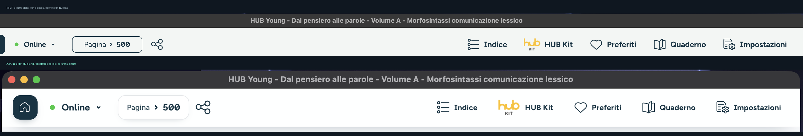

# HUB Young Polish

Restyling della UI di **HUB Young** (l'app Mondadori per i libri digitali).
Non tocca libri, DRM, account o annotazioni: cambia solo l'aspetto e qualche
scorciatoia. Tutto reversibile con un comando.

## Cosa cambia

**Barra superiore**
- altezza 64px, sfondo bianco con leggera sfocatura e ombra discreta
- Home trasformata in un riquadro 40×40 coerente
- voci (Indice, HUB Kit, Preferiti, Quaderno, Impostazioni) con area di click
  40px, etichette 12,5px leggibili, hover e stato attivo
- indicatore pagina "Pagina › 500" come pill con bordo e numero in evidenza
- frecce di cambio pagina più grandi, con hover

**Toolbar inferiore**
- etichette e icone più leggibili, pulsanti con hover e stato attivo
- divisori più morbidi, niente più pulsanti "invisibili"
- zoom: via il verde lime, dentro pulsanti neutri coerenti col resto

**Libreria**
- card dei libri come schede bianche con bordo, ombra e sollevamento al passaggio
- "Sfoglia" scuro e leggibile al posto del verde lime
- filtri (Ordina per / Editore / Preferiti) come pill coerenti
- ricerca e Menu ridisegnati, barra inferiore più pulita

**Modali, tooltip, menu utente**
- angoli arrotondati, ombre morbide, colori coerenti

**Accessibilità**
- focus visibile su tutti i controlli
- rispetto di "Riduci movimento" di macOS
- tooltip (`title`/`aria-label`) aggiunti ai pulsanti che non li avevano

## Scorciatoie aggiunte

| Tasto | Azione |
|-------|--------|
| `Z` | modalità lettura: nasconde le barre; passando il mouse in alto o in basso riappaiono |
| `F` | schermo intero |

Non si attivano mentre scrivi in un campo di testo.

## Installazione

1. Chiudi HUB Young.
2. Doppio click su `installa.command` (oppure, da Terminale:
   `./installa.command "/Applications/HUB Young.app"`).
3. Riapri l'app.

Lo script:
- crea un backup `index.html.ny-backup` **una sola volta**
- aggiunge una riga di CSS e una di JS a `index.html`
- copia `hub-young-polish.css` e `hub-young-polish.js` dentro l'app
- rigenera la firma locale (ad-hoc) per evitare che macOS blocchi l'avvio

## Disinstallazione

`./disinstalla.command` ripristina l'`index.html` originale, cancella i due
file aggiunti e rifirma. Nessun dato personale viene toccato.

## Note importanti

- **Gli aggiornamenti automatici dell'app sovrascrivono la patch.** Dopo un
  update di HUB Young va rilanciato `installa.command` (il backup originale
  resta valido, lo script riconosce di essere già installato).
- La firma dell'app diventa **ad-hoc**: è normale, l'app funziona. Se macOS
  dovesse lamentarsi, reinstalla HUB Young dal sito Mondadori e riapplica.
- La patch non aggira il DRM né cambia il modo in cui l'app verifica licenze:
  i limiti "di sostanza" (login, sincronizzazione, lentezza del backend)
  restano quelli di Mondadori.
- I selettori sono presi dal CSS compilato dell'app (Angular + NW.js). Se un
  futuro aggiornamento rinomina le classi, alcune regole smettono di
  applicarsi: in quel caso si aggiorna il CSS, senza effetti collaterali.

## File

| File | Ruolo |
|------|-------|
| `hub-young-polish.css` | restyling (solo chrome: barre, card, modali) |
| `hub-young-polish.js` | modalità lettura, scorciatoie, tooltip |
| `installa.command` | installa e riavvia |
| `disinstalla.command` | ripristina l'originale |
| `docs/prima-dopo-barra.png` | confronto prima/dopo |

## Licenza

Il progetto è distribuito con licenza MIT — vedi il file [LICENSE](LICENSE).

Questo progetto non è affiliato a Mondadori/HUB Young; è una patch non ufficiale
fornita così com'è, senza garanzie.
